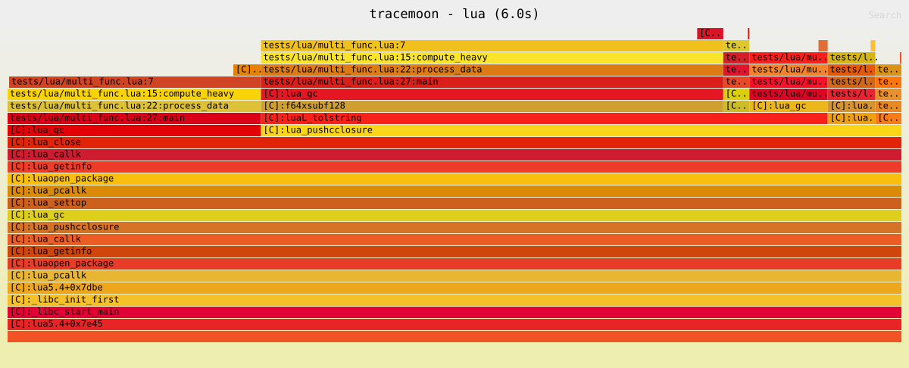

# tracemoon

[](https://github.com/myzhan/tracemoon/actions/workflows/ci.yml)

A sampling profiler for Lua 5.4 and 5.5, inspired by [py-spy](https://github.com/benfred/py-spy). Attach to a running Lua process, capture mixed Lua + C call stacks, and generate interactive flamegraph SVGs. It also profiles [skynet](https://github.com/cloudwu/skynet) processes that host many Lua VMs in a single process.

## Example flamegraphs

Plain single-VM Lua — the native C chain (`_libc_start_main → main → luaV_execute → …`) is unwound and merged beneath the Lua frames:

[](assets/flamegraph-lua.svg)

skynet — each service's Lua VM is rendered under its own `[service:name]` root frame (native C merge is intentionally skipped in multi-VM mode):

[](assets/flamegraph-skynet.svg)

> These are static previews. Open the SVGs locally (or run your own `record`) for the fully interactive, zoomable flamegraph.

## Features

- **Zero instrumentation** - attaches to running Lua processes without modification
- **Multiple Lua versions** - supports Lua 5.4 and 5.5, auto-detected (or forced with `--lua-version`)
- **skynet multi-VM** - enumerates every service's Lua VM and renders each under a `[service:name]` root frame
- **Mixed stacks** - captures both Lua and native C call stacks, merged together (single-VM mode). On Linux x86_64 the native chain (`luaV_execute → … → main`) is unwound via libunwind; in spawn mode this works without root
- **Three output modes** - `record` (flamegraph/collapsed file), `dump` (one-shot stack snapshot), and `top` (live hottest-functions view), à la py-spy
- **Lua heap ownership** - Linux Lua 5.4 whole-process captures, portable offline reports,
  large objects, module fields and upvalue holding paths, with bounded capture budgets
- **Symbol resolution** - resolves C function names from Mach-O/ELF symbol tables (ELF *and* Mach-O load-base math, including `__PAGEZERO` and the Mach-O `_` symbol prefix)
- **Lua debug info** - extracts the source chunk and current line for every Lua frame; only the main chunk is named (`main`), because Lua records no function names (see [How It Works](#how-it-works))
- **Flamegraph SVG** - generates interactive flamegraphs directly (via [inferno](https://github.com/jonhoo/inferno))
- **Cross-platform** - supports Linux and macOS (x86_64 / ARM64)

## Quick Start

```bash
cargo build --release

# Start a Lua process
lua tests/lua/multi_func.lua &
PID=$!

# Profile for 10 seconds, generate flamegraph
sudo ./target/release/tracemoon record -p $PID -d 10

# Open flamegraph.svg in a browser
open flamegraph.svg
```

## Usage

```
tracemoon <SUBCOMMAND> [OPTIONS] [-- <COMMAND>...]

SUBCOMMANDS:
  record         Record a profile to a flamegraph / collapsed file
  dump           Print a one-shot snapshot of the current stack(s) and exit
  top            Live-updating terminal view of the hottest functions
  mem capture    Pause a Linux Lua 5.4 process and save its heap graph
  mem report     Analyze a heap snapshot or Linux ELF core offline
  mem inspect    Show one captured object's holding paths and preview

OPTIONS (record / top):
  -p, --pid <PID>          Attach to a running Lua process by PID
  -r, --rate <HZ>          Sample rate in Hz (default: 100)
  -d, --duration <SECS>    Duration in seconds (0 = until Ctrl+C, default: 0)
  -o, --output <FILE>      Output file, record only (default: flamegraph.svg)
      --lua-version <VER>  Force the Lua layout: 5.4 or 5.5 (default: auto-detect)
      --service <VALUE>    Select a skynet service by exact label or :xxxxxxxx handle
                           (repeatable; also supported by dump)

`dump` takes -p / --lua-version / --service / -- <command> (no rate, duration, or output).
```

CPU profiling subcommands accept two target modes; specify exactly one target:

- **Attach** (`-p <PID>`): profile a process that is already running. Anything that
  happened before you attach is not captured.
- **Spawn** (`-- <command>`): tracemoon launches the command itself and profiles it from
  the very start, so startup work isn't missed. On Linux the child is held at the exec
  boundary (via `PTRACE_TRACEME`) until sampling is ready, then resumed. When profiling
  ends (Ctrl+C or the duration limit), the spawned child is terminated (SIGTERM, then
  SIGKILL if needed). If the child exits on its own first, tracemoon stops cleanly. On
  macOS spawn is best-effort and may miss a small startup window.

Output format is determined by file extension:
- `.svg` - interactive flamegraph (default)
- `.txt` - collapsed stacks, compatible with [flamegraph.pl](https://github.com/brendangregg/FlameGraph)

Each `record` file also gets a `<output>.meta.json` sidecar with tool version, target PID,
spawn argv (null for attach), service filters, Lua layout and confirmation status, requested
sample rate, start time in Unix seconds, actual elapsed sampling time, and tick/stack counts.
Child shutdown and output generation are excluded from that elapsed time. A sampling error
still attempts to save the partial profile; the original sampling error remains the exit
error if saving also fails. This does not provide periodic checkpoints or SIGKILL recovery.

`--service` matches the exact discovered label (including a leading dot, if present) or a
lowercase eight-digit handle such as `:01000012`, even when that service also has a name.
Filters are ORed and applied before stack walking in `record`, `dump`, and `top`.
Non-skynet targets reject this option. When no selected service is present or walkable,
ticks yield no usable stacks; the success rate describes the selected services only.

### Examples

```bash
# Default: flamegraph SVG
sudo tracemoon record -p 12345 -d 5

# Collapsed stacks for external tools
sudo tracemoon record -p 12345 -d 5 -o profile.txt

# Higher sample rate, custom output
sudo tracemoon record -p 12345 -r 200 -d 10 -o flame.svg

# Force a Lua version instead of auto-detecting
sudo tracemoon record -p 12345 -d 5 --lua-version 5.5

# Profile a skynet process (multi-VM mode is auto-selected)
sudo tracemoon record -p $(pgrep -f skynet) -d 10 -o skynet.svg

# Select two skynet services (exact labels or handles)
sudo tracemoon record -p 12345 --service .logger --service :01000012 -d 10

# Spawn mode: launch the target yourself and profile from the start
sudo tracemoon record -d 5 -o out.svg -- lua tests/lua/multi_func.lua

# Spawn a skynet benchmark and capture it from process start
sudo tracemoon record -d 10 -o skynet.svg -- ./skynet ../benchmark/config

# One-shot snapshot of the current stack(s), printed to stdout
tracemoon dump -- lua tests/lua/multi_func.lua
sudo tracemoon dump -p 12345

# Live "top functions" view (%Own = leaf time, %Total = anywhere in stack)
tracemoon top -- lua tests/lua/multi_func.lua
sudo tracemoon top -p 12345 -r 200
```

Because spawn mode makes tracemoon the target's parent, ptrace seize is permitted even under
`kernel.yama.ptrace_scope=1` — so native C stacks (and `dump`/`top`) work **without root** on
Linux when you spawn the target. Attaching to an existing PID still needs root /
`CAP_SYS_PTRACE`. On macOS both modes need root, because `task_for_pid` is what actually
reads the target (even for a child we spawned).

## Memory analysis

Capture a single Lua 5.4 heap snapshot on 64-bit Linux:

```bash
sudo tracemoon mem capture -p 12345 -o heap.tmoon
sudo tracemoon mem capture -p 12345 --service :01000012 -o player.tmoon

# Spawn a target, allow initialization, capture, then terminate that child.
tracemoon mem capture --startup-ms 500 -o heap.tmoon -- lua5.4 app.lua

# Analyze saved data after the target has resumed or exited; also works on macOS.
tracemoon mem report heap.tmoon --top 20 -o heap-report.txt
tracemoon mem inspect heap.tmoon --object 0x12345678

# Include raw pointers when debugging or finding an exact address to inspect.
tracemoon mem report heap.tmoon --show-addresses -o detailed-report.txt

# Interactive standalone HTML (inferred from .html, or set explicitly).
tracemoon mem report heap.tmoon -o report.html
tracemoon mem report heap.tmoon --format html -o report.html

# Analyze a Linux ELF core directly; no import/conversion command is needed
tracemoon mem report core.dump --exe ./skynet -o report.html
tracemoon mem report core.dump --exe ./lua -o report.txt
tracemoon mem report core.dump --exe ./skynet --service trace_alpha -o alpha.html
```

Capture pauses **all threads** while reading Lua objects and references. Analysis and file
serialization happen after resume. The default best-effort pause budget is 2 seconds;
`--max-pause-ms` changes it (up to 60 seconds). Other limits are `--max-objects` (default
1,000,000), `--max-edges` (2,000,000), and `--max-read-mib` (256, including discovery).
Cleanup may exceed the pause budget. `--state 0x...` bypasses scanning when a single-VM
target's lua_State address is already known. Resource exhaustion or inconsistent reads save
an explicitly incomplete snapshot and return a nonzero exit code. Failures before successful
freeze may return without a snapshot. Target code is never injected and GC is never forced.

The default text report is printed to stdout; `heap.tmoon` stores a versioned JSON object
graph for later reporting and object inspection. The report shows a service allocation
ranking, type totals, large-object candidates, shallow/reachable sizes, bounded entry
previews, and strong holding paths such as:

```text
player.cache → sessions
```

An object is counted once per heap. Reachable sizes include shared objects and cannot be
added across entries. Candidate ranking is bounded, not a precise retained-size ranking.
Functions may provide source/upvalue clues; tables do not record allocation source lines.
Default reports use object types and per-service object numbers in place of raw pointers.
Named module-field holding paths take precedence over shorter stack-slot paths; memory
accounting still uses the same strong reference graph. `--show-addresses` on `report` or
`inspect` includes exact addresses. Object numbers are display references within each
service, not addresses accepted by `--object`.

Input is detected by content: either a saved `.tmoon` graph or a raw Linux ELF64 core
(little-endian x86_64/aarch64). Core analysis works offline on 64-bit Linux and macOS,
without ptrace or a live PID. Supply the matching ELF binary with `--exe`; skynet needs
an unstripped binary containing `H` to select its patched Lua ABI and discover services.
PIE relocation comes from the core's `AT_PHDR` or `NT_FILE` mappings. Dumped executable
notes are compared when available to reject a mismatched build. Only omitted immutable
bytes from the explicitly supplied binary can be recovered; shared-library recovery is
not yet supported. Missing heap pages and decoding failures produce an incomplete report.
If Lua version detection is unavailable, `--lua-version 5.4` asserts a verified version;
`--state 0x...` optionally selects a known single-VM state. `mem inspect` accepts the same
core input and `--exe`. Lua 5.5 heaps, compressed cores, and macOS Mach-O cores are not
supported. Export a systemd-managed core with `coredumpctl dump -o core.dump` first.
Offline core extraction has fixed limits of 60 seconds, 1 GiB requested memory reads,
1 million objects and 2 million edges. Unknown original PID/time/pause metadata is not
presented as a measured capture. A core can contain a heap interrupted mid-update or
damaged before the crash; extraction does not run GC or establish a leak verdict.

`mem report` supports `--format text|html`; an explicit format overrides the extension.
Without `--format`, `.html`/`.htm` selects HTML and other paths/stdout use text. HTML embeds
its styles and scripts and works offline, with service filters, search, a compact sortable
object table, and row details for holding paths/examples. Module grouping
is a presentation heuristic; completeness and conservative GC semantics remain visible.

Initial capture support is **64-bit Lua 5.4** and **skynet v1.8.0's patched Lua 5.4.7**,
not Lua 5.5 or LuaJIT. The `H` symbol selects the skynet ABI, which is recorded in snapshots.
Weak/conditional references are identified conservatively; ephemeron convergence
and finalization semantics are not fully modeled. “Unconfirmed reachable” does not mean
“garbage” or “leak.” Object totals exclude native pointees, allocator overhead, global state
and string hash buckets, so they are not RSS. Snapshots retain field names and short string
previews and may contain business data.

Local macOS validation covers graph decoding, reports, and offline inspection; actual Linux
freeze/resume and capture smoke tests are included in CI. See the
[memory design](docs/memory-snapshot-design.md) for scope and remaining limitations.

## CPU sample output

```
Sampling statistics:
  Duration: 5.0s
  Sampling ticks: 500
  Successful ticks: 497
  Failed ticks: 3
  Success rate: 99.4%
  Stacks sampled: 497
  Unique stacks: 4

  Top stacks:
    [33.1%] (165 samples)
      ├─ [C]:pmain
      ├─ tests/lua/multi_func.lua:27:main
      ├─ tests/lua/multi_func.lua:22
      ├─ tests/lua/multi_func.lua:15
      ├─ tests/lua/multi_func.lua:7
      ├─ [C]:math_sin
      ├─ [C]:luaV_execute
      ├─ ...
      └─ [C]:main
```

Ticks and stacks are counted separately: one tick yields one stack in single-VM mode but one
stack *per service* in skynet mode, so the success rate is computed over ticks while stack
percentages use the sampled-stack count. A non-100% rate is healthy — sampling a running
process means occasionally reading a half-written structure.

## Requirements

- Rust 1.82+
- Target: Lua 5.4.x / 5.5.x processes (including skynet)
- **Linux, attach mode:** root or `CAP_SYS_PTRACE` (spawn mode needs neither)
- **macOS:** root (`sudo`) required for `task_for_pid`, in both modes

## How It Works

1. **Attach** to a running Lua process (via `-p`), or **spawn** the target yourself (via
   `-- <cmd>`) and hold it at the exec boundary so no startup samples are missed
2. **Detect** the Lua version (5.4/5.5) from the target binary's rodata and select the matching memory layout
3. **Discover** the Lua VM(s):
   - Plain Lua: scan process memory for a valid `lua_State`
   - skynet: walk the `H` (`handle_storage`) global → service slots → `snlua.activeL`, one VM per service
4. **Sample** at configurable frequency (default 100 Hz):
   - Walk each VM's Lua `CallInfo` chain for Lua-level stacks
   - Single-VM mode also unwinds the native C stack (libunwind-ptrace on Linux x86_64, frame
     pointers via `task_for_pid` on macOS) and merges it beneath the Lua frames
   - skynet mode prepends a `[service:name]` root frame per VM (native merge is skipped, since a
     ptrace register snapshot maps to one worker thread, not a specific VM)
5. **Resolve** symbols:
   - Lua: read `Proto.source` (TString) for the chunk name and `Proto.lineinfo` for the line.
     Lua stores no function names; `Upvaldesc.name` holds *captured variable* names, so using
     it would label a function after one of its callees. Only the main chunk
     (`linedefined == 0`) is named `main`; other frames render as `source:line`.
   - C: parse Mach-O/ELF symbol tables from mapped binaries (undefined imports excluded,
     load base taken from the lowest mapping / `__TEXT`)
6. **Output** aggregated stacks as flamegraph SVG or collapsed text

Deeper design notes are in [docs/lua-profiler-ptrace.md](docs/lua-profiler-ptrace.md); what we
plan to build next (temporal views, speedscope, per-service views, heap analysis,
LuaJIT) is in [docs/roadmap.md](docs/roadmap.md).

The memory subsystem is described separately in
[Lua heap snapshot design](docs/memory-snapshot-design.md), including the initial implementation
scope and remaining work. Single-snapshot ownership reports take priority over comparisons.

## Debug Logging

```bash
sudo RUST_LOG=debug ./target/debug/tracemoon record -p 12345 -d 2
```

## Building

```bash
cargo build           # debug
cargo build --release # optimized
cargo test            # unit tests (no target process needed)
cargo clippy --all-targets -- -D warnings
cargo fmt --check
```

The Lua and skynet upstreams are pinned test submodules. Initialize and build them with:

```bash
git submodule update --init tests/vendor/lua tests/vendor/skynet
bash tests/build-vendor.sh

# Linux acceptance: actual CLI capture of both kinds of processes, without root.
cargo test --release --test integration -- --ignored --test-threads=1
```

CI builds both vendors, validates both Lua ABIs, and runs unit tests on Linux/macOS. A
dedicated Linux integration job checks CPU stacks, heap objects, service filters and
offline reports for plain Lua and skynet. See [tests/README.md](tests/README.md) for pins,
portable decoder tests, build outputs and acceptance criteria. The default unit suite
does not run the explicitly ignored real-process tests.

## License

MIT
