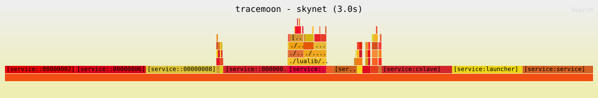

# tracemoon

[](https://github.com/myzhan/tracemoon/actions/workflows/ci.yml)

A sampling profiler for Lua 5.4 and 5.5, inspired by [py-spy](https://github.com/benfred/py-spy). Attach to a running Lua process, capture mixed Lua + C call stacks, and generate interactive flamegraph SVGs. It also profiles [skynet](https://github.com/cloudwu/skynet) processes that host many Lua VMs in a single process.

## Example flamegraphs

Plain single-VM Lua — the native C chain (`_libc_start_main → main → luaV_execute → …`) is unwound and merged beneath the Lua frames:

[](assets/flamegraph-lua.svg)

skynet — each service's Lua VM is rendered under its own `[service:name]` root frame (native C merge is intentionally skipped in multi-VM mode):

[](assets/flamegraph-skynet.svg)

> These are static previews. Open the SVGs locally (or run your own `record`) for the fully interactive, zoomable flamegraph.

## Features

- **Zero instrumentation** - attaches to running Lua processes without modification
- **Multiple Lua versions** - supports Lua 5.4 and 5.5, auto-detected (or forced with `--lua-version`)
- **skynet multi-VM** - enumerates every service's Lua VM and renders each under a `[service:name]` root frame
- **Mixed stacks** - captures both Lua and native C call stacks, merged together (single-VM mode). On Linux x86_64 the native chain (`luaV_execute → … → main`) is unwound via libunwind; in spawn mode this works without root
- **Three output modes** - `record` (flamegraph/collapsed file), `dump` (one-shot stack snapshot), and `top` (live hottest-functions view), à la py-spy
- **Symbol resolution** - resolves C function names from Mach-O/ELF symbol tables (ELF *and* Mach-O load-base math, including `__PAGEZERO` and the Mach-O `_` symbol prefix)
- **Lua debug info** - extracts the source chunk and current line for every Lua frame; only the main chunk is named (`main`), because Lua records no function names (see [How It Works](#how-it-works))
- **Flamegraph SVG** - generates interactive flamegraphs directly (via [inferno](https://github.com/jonhoo/inferno))
- **Cross-platform** - supports Linux and macOS (x86_64 / ARM64)

## Quick Start

```bash
cargo build --release

# Start a Lua process
lua tests/lua/multi_func.lua &
PID=$!

# Profile for 10 seconds, generate flamegraph
sudo ./target/release/tracemoon record -p $PID -d 10

# Open flamegraph.svg in a browser
open flamegraph.svg
```

## Usage

```
tracemoon <SUBCOMMAND> [OPTIONS] [-- <COMMAND>...]

SUBCOMMANDS:
  record   Record a profile to a flamegraph / collapsed file
  dump     Print a one-shot snapshot of the current stack(s) and exit
  top      Live-updating terminal view of the hottest functions

OPTIONS (record / top):
  -p, --pid <PID>          Attach to a running Lua process by PID
  -r, --rate <HZ>          Sample rate in Hz (default: 100)
  -d, --duration <SECS>    Duration in seconds (0 = until Ctrl+C, default: 0)
  -o, --output <FILE>      Output file, record only (default: flamegraph.svg)
      --lua-version <VER>  Force the Lua layout: 5.4 or 5.5 (default: auto-detect)

`dump` takes only -p / --lua-version / -- <command> (no rate, duration, or output).
```

Every subcommand accepts the same two target modes; specify exactly one target:

- **Attach** (`-p <PID>`): profile a process that is already running. Anything that
  happened before you attach is not captured.
- **Spawn** (`-- <command>`): tracemoon launches the command itself and profiles it from
  the very start, so startup work isn't missed. On Linux the child is held at the exec
  boundary (via `PTRACE_TRACEME`) until sampling is ready, then resumed. When profiling
  ends (Ctrl+C or the duration limit), the spawned child is terminated (SIGTERM, then
  SIGKILL if needed). If the child exits on its own first, tracemoon stops cleanly. On
  macOS spawn is best-effort and may miss a small startup window.

Output format is determined by file extension:
- `.svg` - interactive flamegraph (default)
- `.txt` - collapsed stacks, compatible with [flamegraph.pl](https://github.com/brendangregg/FlameGraph)

### Examples

```bash
# Default: flamegraph SVG
sudo tracemoon record -p 12345 -d 5

# Collapsed stacks for external tools
sudo tracemoon record -p 12345 -d 5 -o profile.txt

# Higher sample rate, custom output
sudo tracemoon record -p 12345 -r 200 -d 10 -o flame.svg

# Force a Lua version instead of auto-detecting
sudo tracemoon record -p 12345 -d 5 --lua-version 5.5

# Profile a skynet process (multi-VM mode is auto-selected)
sudo tracemoon record -p $(pgrep -f skynet) -d 10 -o skynet.svg

# Spawn mode: launch the target yourself and profile from the start
sudo tracemoon record -d 5 -o out.svg -- lua tests/lua/multi_func.lua

# Spawn a skynet benchmark and capture it from process start
sudo tracemoon record -d 10 -o skynet.svg -- ./skynet ../benchmark/config

# One-shot snapshot of the current stack(s), printed to stdout
tracemoon dump -- lua tests/lua/multi_func.lua
sudo tracemoon dump -p 12345

# Live "top functions" view (%Own = leaf time, %Total = anywhere in stack)
tracemoon top -- lua tests/lua/multi_func.lua
sudo tracemoon top -p 12345 -r 200
```

Because spawn mode makes tracemoon the target's parent, ptrace seize is permitted even under
`kernel.yama.ptrace_scope=1` — so native C stacks (and `dump`/`top`) work **without root** on
Linux when you spawn the target. Attaching to an existing PID still needs root /
`CAP_SYS_PTRACE`. On macOS both modes need root, because `task_for_pid` is what actually
reads the target (even for a child we spawned).

## Sample Output

```
Sampling statistics:
  Duration: 5.0s
  Sampling ticks: 500
  Successful ticks: 497
  Failed ticks: 3
  Success rate: 99.4%
  Stacks sampled: 497
  Unique stacks: 4

  Top stacks:
    [33.1%] (165 samples)
      ├─ [C]:pmain
      ├─ tests/lua/multi_func.lua:27:main
      ├─ tests/lua/multi_func.lua:22
      ├─ tests/lua/multi_func.lua:15
      ├─ tests/lua/multi_func.lua:7
      ├─ [C]:math_sin
      ├─ [C]:luaV_execute
      ├─ ...
      └─ [C]:main
```

Ticks and stacks are counted separately: one tick yields one stack in single-VM mode but one
stack *per service* in skynet mode, so the success rate is computed over ticks while stack
percentages use the sampled-stack count. A non-100% rate is healthy — sampling a running
process means occasionally reading a half-written structure.

## Requirements

- Rust 1.82+
- Target: Lua 5.4.x / 5.5.x processes (including skynet)
- **Linux, attach mode:** root or `CAP_SYS_PTRACE` (spawn mode needs neither)
- **macOS:** root (`sudo`) required for `task_for_pid`, in both modes

## How It Works

1. **Attach** to a running Lua process (via `-p`), or **spawn** the target yourself (via
   `-- <cmd>`) and hold it at the exec boundary so no startup samples are missed
2. **Detect** the Lua version (5.4/5.5) from the target binary's rodata and select the matching memory layout
3. **Discover** the Lua VM(s):
   - Plain Lua: scan process memory for a valid `lua_State`
   - skynet: walk the `H` (`handle_storage`) global → service slots → `snlua.activeL`, one VM per service
4. **Sample** at configurable frequency (default 100 Hz):
   - Walk each VM's Lua `CallInfo` chain for Lua-level stacks
   - Single-VM mode also unwinds the native C stack (libunwind-ptrace on Linux x86_64, frame
     pointers via `task_for_pid` on macOS) and merges it beneath the Lua frames
   - skynet mode prepends a `[service:name]` root frame per VM (native merge is skipped, since a
     ptrace register snapshot maps to one worker thread, not a specific VM)
5. **Resolve** symbols:
   - Lua: read `Proto.source` (TString) for the chunk name and `Proto.lineinfo` for the line.
     Lua stores no function names; `Upvaldesc.name` holds *captured variable* names, so using
     it would label a function after one of its callees. Only the main chunk
     (`linedefined == 0`) is named `main`; other frames render as `source:line`.
   - C: parse Mach-O/ELF symbol tables from mapped binaries (undefined imports excluded,
     load base taken from the lowest mapping / `__TEXT`)
6. **Output** aggregated stacks as flamegraph SVG or collapsed text

Deeper design notes are in [docs/lua-profiler-ptrace.md](docs/lua-profiler-ptrace.md); what we
plan to build next (long-tail stalls, speedscope, per-service views, memory sampling,
LuaJIT) is in [docs/roadmap.md](docs/roadmap.md).

## Debug Logging

```bash
sudo RUST_LOG=debug ./target/debug/tracemoon record -p 12345 -d 2
```

## Building

```bash
cargo build           # debug
cargo build --release # optimized
cargo test            # unit tests (no target process needed)
cargo clippy --all-targets -- -D warnings
cargo fmt --check
```

CI runs all four on Linux and macOS; the Linux job also launches `lua5.4` in spawn mode and
asserts the run produced samples, which is the end-to-end check that stack walking, symbol
resolution and the tick loop still work.

## License

MIT
